# Tip Calculator

Calculadora de propinas para Android: el usuario teclea el monto en centavos, elige un porcentaje de 0 a 30 % con un SeekBar y la app muestra la propina y el total con el formato de moneda de su país.

Es la migración del **capítulo 3 de Deitel (2016)**, escrito en Java para Android 6, a **Kotlin y Android 16 (API 36)**, con dominio separado, dinero en `BigDecimal` y pruebas automatizadas.


> **Práctica 03** · Aplicaciones Móviles · Universidad Técnica de Ambato, FISEI
> Autor: Acosta Nuñez Edison Joel · Docente: Ing. Aladaz Flores Clay Fernando

---

## Capturas

<table>
  <tr>
    <td align="center">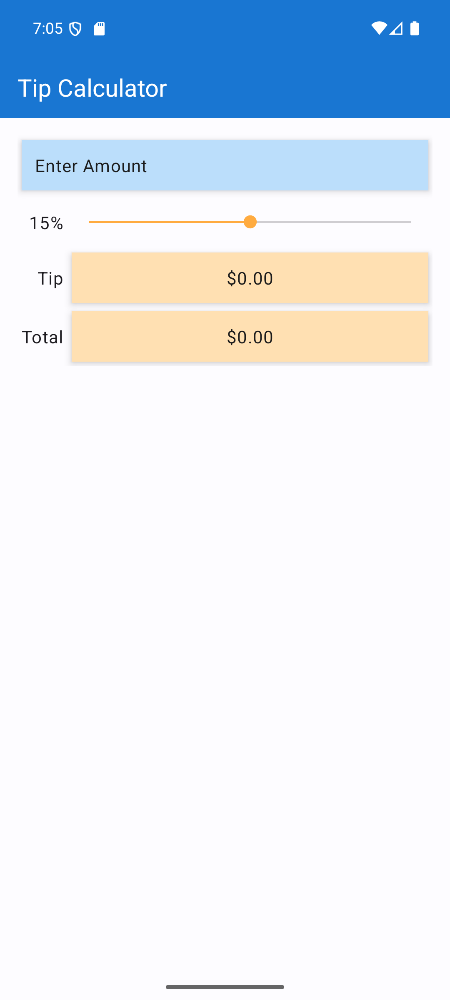<br><sub>Inicio: teclado visible, 15 %</sub></td>
    <td align="center">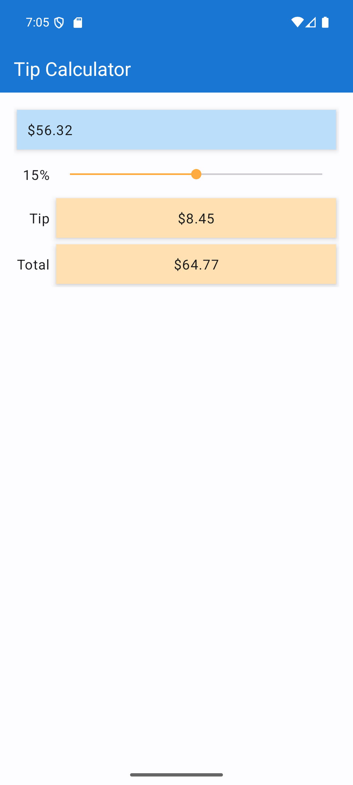<br><sub>$56.32 al 15 %</sub></td>
    <td align="center">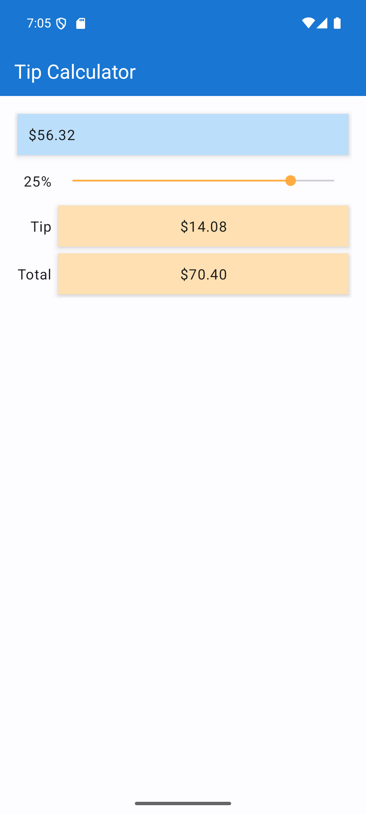<br><sub>Escenario del PDF: 25 %</sub></td>
  </tr>
  <tr>
    <td align="center">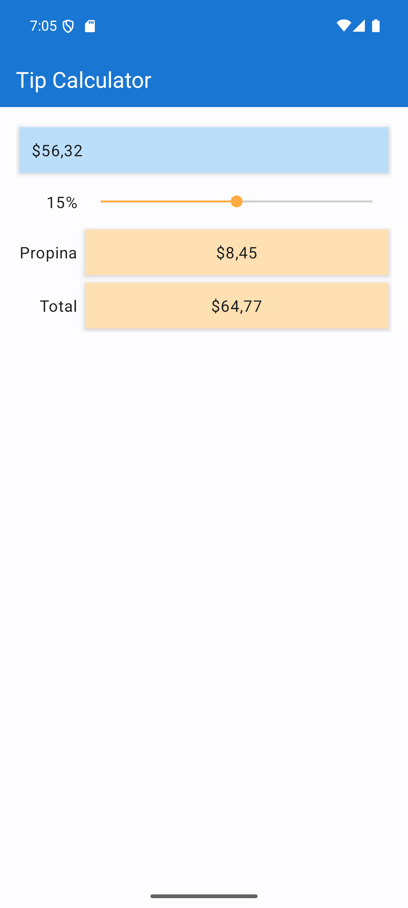<br><sub>Español (es-EC)</sub></td>
    <td align="center">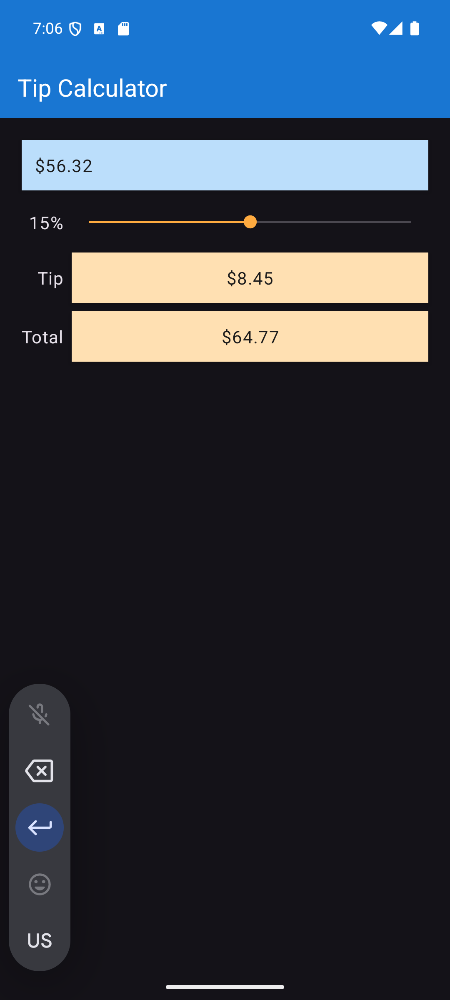<br><sub>Modo oscuro</sub></td>
    <td align="center">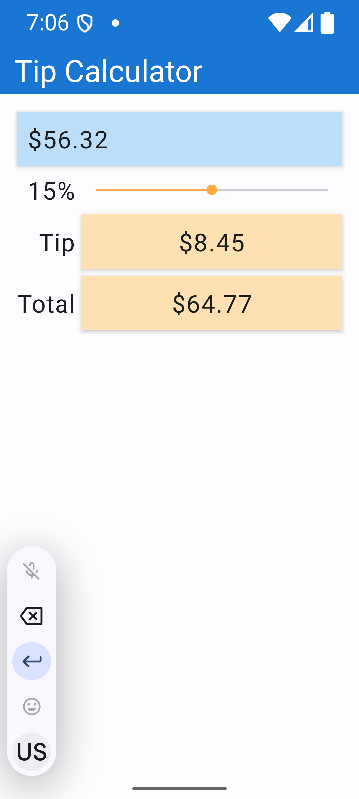<br><sub>Fuente al 200 %</sub></td>
  </tr>
  <tr>
    <td align="center">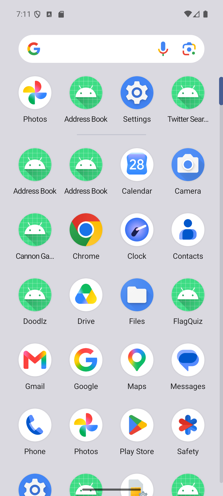<br><sub>Ícono en el lanzador</sub></td>
    <td align="center">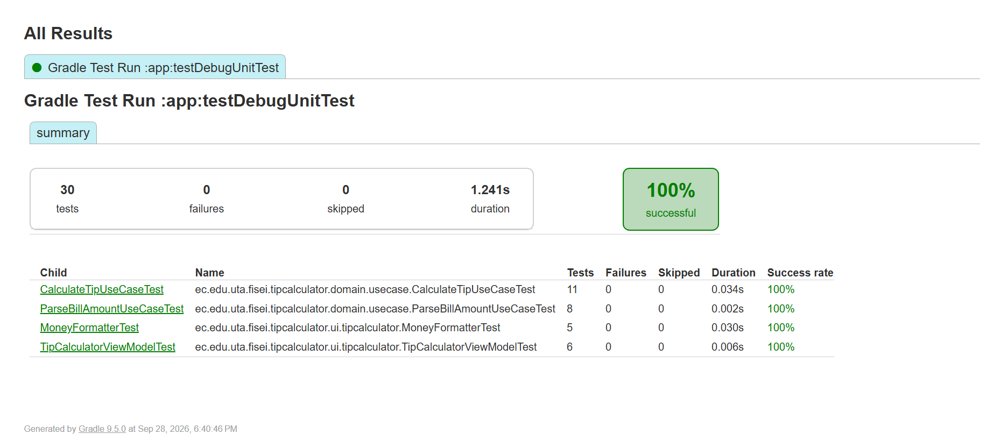<br><sub>30 pruebas unitarias</sub></td>
    <td align="center">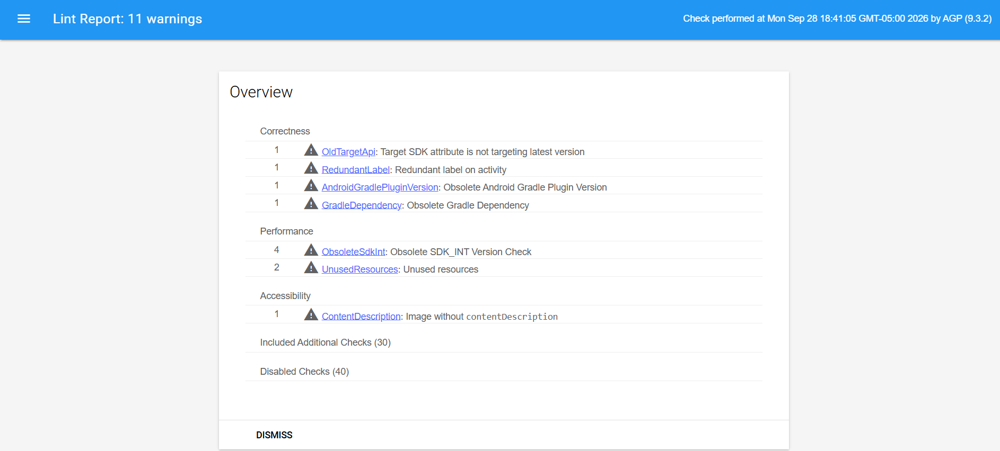<br><sub>Lint: 0 errores</sub></td>
  </tr>
</table>

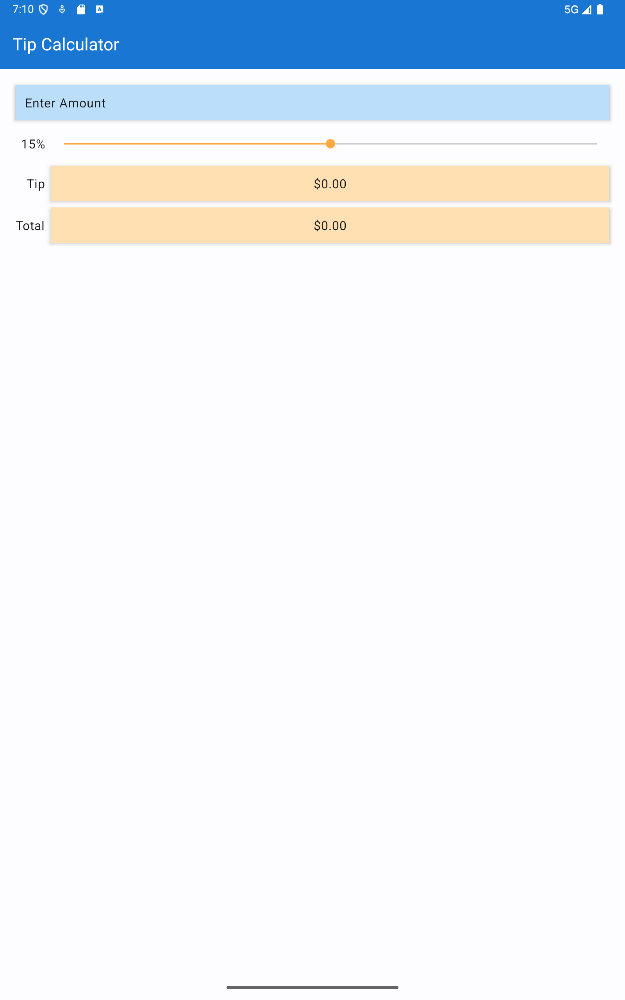<br><sub>Pixel Tablet, API 36: orientación en pantalla grande</sub>

---

## Funcionalidades

- **Monto en centavos:** al teclear 5, 6, 3, 2 el monto pasa por $0.05, $0.56, $5.63 y $56.32. Solo se aceptan dígitos, hasta 6 ($9999.99).
- **Porcentaje de 0 a 30 %** con un SeekBar; el rango sale del dominio, no de un número suelto.
- **Cálculo exacto** con `BigDecimal` y redondeo `HALF_UP`. El total se deriva de la propina ya redondeada, así que lo que se muestra siempre suma.
- **Formato por país:** moneda y porcentaje según el idioma y la región del dispositivo.
- **Teclado numérico visible al abrir**, como pide el PDF.
- **Inglés y español**, modo oscuro, edge-to-edge y etiquetas para TalkBack.

---

## Qué cambió respecto al libro

|                 | PDF (2016)                                  | Este proyecto                                           |
| --------------- | ------------------------------------------- | ------------------------------------------------------- |
| Lenguaje        | Java                                        | Kotlin                                                  |
| Bibliotecas     | Support Library (`android.support.v7`)      | AndroidX y Material 3                                   |
| Dinero          | `double` (contra su propia Obs. 3.3)        | `BigDecimal`, escala 2, `HALF_UP`                       |
| Propina y total | Redondeados por separado al formatear       | Total = monto + propina redondeada (invariante probada) |
| Lógica          | Dentro de la Activity y clases anónimas     | Casos de uso + ViewModel                                |
| Vistas          | `findViewById` + casts                      | ViewBinding                                             |
| Tema            | AppCompat Light DarkActionBar, Theme Editor | Material 3 DayNight + MaterialToolbar, `themes.xml`     |
| Barra superior  | Blue 500 con título blanco (3,1:1)          | Blue 700 (4,6:1)                                        |
| Pruebas         | 0                                           | 30 unitarias + 4 instrumentadas                         |

- **Correcciones de compatibilidad**, una por fila: [docs/COMPATIBILIDAD.md](docs/COMPATIBILIDAD.md)
- **Principios de diseño**, malos olores y errores del libro: [docs/ANALISIS_DISENO.md](docs/ANALISIS_DISENO.md)

---

## Arquitectura

MVVM con dominio puro. El dominio no depende de Android y se prueba en la JVM.

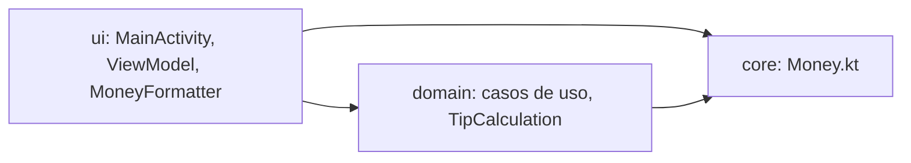

| Capa     | Contenido                                                                 |
| -------- | ------------------------------------------------------------------------- |
| `core`   | Escala, redondeo y constante 100 para todos los montos                    |
| `domain` | `ParseBillAmountUseCase`, `CalculateTipUseCase`, `TipCalculation`         |
| `ui`     | Activity, `TipCalculatorViewModel`, `MoneyFormatter` (formato por locale) |
| `data`   | Vacía: la app no guarda nada                                              |

Flujos, estado y decisiones: [docs/ARQUITECTURA.md](docs/ARQUITECTURA.md)

---

## Tecnologías

| Herramienta                        | Versión                   |
| ---------------------------------- | ------------------------- |
| Android Gradle Plugin              | 9.3.2 (Kotlin integrado)  |
| Gradle                             | 9.5.0                     |
| JVM del daemon de Gradle           | 25 (toolchain automática) |
| compileSdk / targetSdk / minSdk    | 37 / 36 / 24              |
| Bytecode                           | Java 11                   |
| AndroidX Core, AppCompat, Activity | 1.19.0, 1.8.0, 1.13.0     |
| Material Components                | 1.14.0                    |
| JUnit, AndroidX JUnit              | 4.13.2, 1.3.0             |
| Espresso, AndroidX Test runner     | 3.7.0, 1.7.0              |

Las versiones están centralizadas en [`gradle/libs.versions.toml`](gradle/libs.versions.toml).

---

## Cómo ejecutarlo

Requisitos: Android Studio con el SDK de Android 37. Gradle descarga el JDK que necesita.

```bash
git clone <url-del-repositorio>
cd P03_TipCalculator

gradlew assembleDebug        # compilar
gradlew installDebug         # instalar en el emulador o dispositivo conectado
```

---

## Pruebas

```bash
gradlew test                        # 30 unitarias, sin emulador
gradlew connectedDebugAndroidTest   # 4 instrumentadas
gradlew lint                        # 0 errores
```

| Tipo           | Cantidad | Qué cubren                                                            |
| -------------- | -------- | --------------------------------------------------------------------- |
| Unitarias      | 30       | Cálculo, redondeo, lectura de centavos, formato por locale, ViewModel |
| Instrumentadas | 4        | Teclear → propina y total en pantalla; SeekBar; borrar                |

Las instrumentadas se ejecutaron en Pixel 7 y Pixel Tablet con API 36 (Android 16).

Estrategia, cobertura y límites: [docs/PRUEBAS.md](docs/PRUEBAS.md)

---

## Documentación

| Documento                                     | Contenido                                        |
| --------------------------------------------- | ------------------------------------------------ |
| [COMPATIBILIDAD.md](docs/COMPATIBILIDAD.md)   | Correcciones del PDF a API 36                    |
| [ANALISIS_DISENO.md](docs/ANALISIS_DISENO.md) | SOLID, STUPID, errores del libro y deuda técnica |
| [ARQUITECTURA.md](docs/ARQUITECTURA.md)       | Capas, flujos, estado y decisiones               |
| [PRUEBAS.md](docs/PRUEBAS.md)                 | Estrategia, cobertura y verificación manual      |
| [PLAN.md](docs/PLAN.md)                       | Fases de desarrollo y sus commits                |

---

## Estructura

```
P03_TipCalculator/
├── app/src/
│   ├── main/java/ec/edu/uta/fisei/tipcalculator/
│   │   ├── core/                 Money.kt: escala, redondeo, constante 100
│   │   ├── domain/model/         TipCalculation
│   │   ├── domain/usecase/       ParseBillAmountUseCase, CalculateTipUseCase
│   │   ├── domain/repository/    Vacía
│   │   ├── data/repository/      Vacía
│   │   └── ui/tipcalculator/     MainActivity, ViewModel, MoneyFormatter
│   ├── test/                     30 pruebas unitarias
│   └── androidTest/              4 pruebas con Espresso
├── docs/                         Documentación y capturas
└── gradle/                       Catálogo de versiones
```

---

## Convenciones

- **Nombres del PDF:** los ids de las vistas (`amountEditText`, `percentSeekBar`, `tipTextView`…) y los recursos (`enter_amount`, `textview_padding`, `amount_background`…) se conservan para poder rastrearlos en el libro.
- **Pruebas:** nombres en español con comillas invertidas, que describen el comportamiento esperado.
- **Commits:** en fases (`Fase N:`), con `fix:`, `chore:` y `docs:`.
- **Referencias al libro:** los comentarios citan la sección o la línea del PDF (por ejemplo, `PDF 3.2`, "líneas 100-103").

---

## Limitaciones conocidas

Detalladas con su riesgo y la acción propuesta en [ANALISIS_DISENO.md §7](docs/ANALISIS_DISENO.md). Las principales:

- El naranja del SeekBar no alcanza el contraste mínimo para componentes (3:1) sobre fondo claro.
- TalkBack no anuncia la propina y el total cuando cambian.
- El bloqueo vertical depende de una exclusión temporal de Android 16.
- El ícono del lanzador es el de la plantilla.

---

## Créditos

- Basado en el capítulo 3 (Tip Calculator App) de P. Deitel, H. Deitel y A. Wald, _Android 6 for Programmers: An App-Driven Approach_, 3.ª ed., Pearson, 2016. Uso académico.
