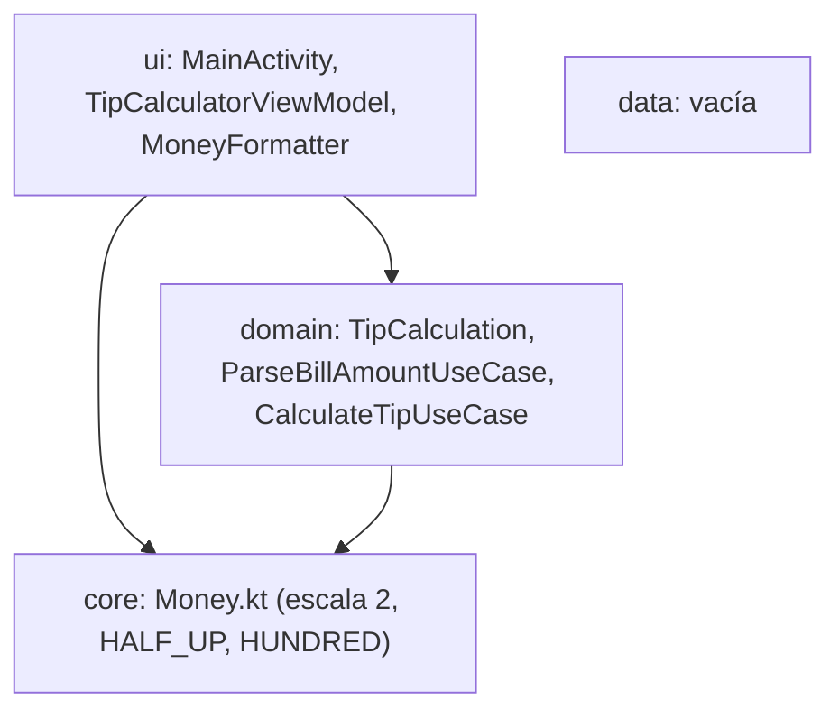
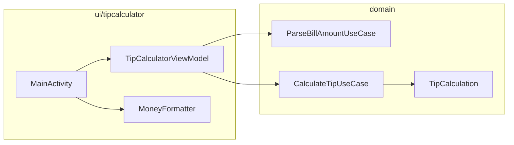
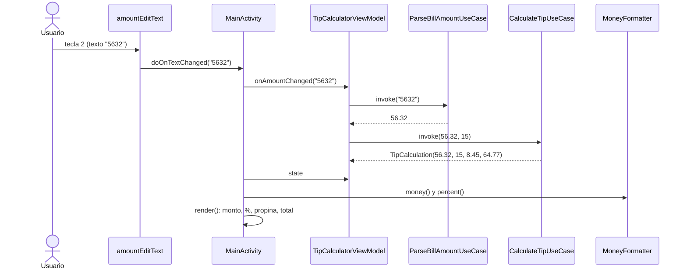

# Tip Calculator — Arquitectura

Cómo está organizado el código, cómo fluyen los datos y por qué se tomó cada decisión. Los principios se analizan en [ANALISIS_DISENO.md](ANALISIS_DISENO.md).

> Las rutas son relativas a `app/src/main/java/ec/edu/uta/fisei/tipcalculator/`.

---

## 1. Vista general

- **Patrón:** MVVM con dominio puro.
- **Pantallas:** una Activity.
- **Estado:** `TipCalculatorViewModel`, con una propiedad `state: TipCalculation`.
- **Inyección de dependencias:** por constructor, con valores por defecto. No hace falta fábrica.

### Capas



| Capa     | Responsabilidad                                | ¿Importa Android?                          |
| -------- | ---------------------------------------------- | ------------------------------------------ |
| `core`   | Política monetaria única                       | No                                         |
| `domain` | Leer centavos, calcular propina y total        | **No** (verificable con `git grep`)        |
| `ui`     | Mostrar, recibir eventos, formatear por locale | Sí (`MoneyFormatter` solo usa `java.text`) |
| `data`   | —                                              | —                                          |

### Componentes



---

## 2. De la clase del PDF a la estructura actual

| Parte del PDF                                | Ahora                                   | Por qué                                             |
| -------------------------------------------- | --------------------------------------- | --------------------------------------------------- |
| `MainActivity.onCreate` + `findViewById`     | `MainActivity` + ViewBinding            | Solo cableado y `render()`                          |
| `currencyFormat` / `percentFormat` estáticos | `MoneyFormatter`                        | Locale por instancia e inyectable                   |
| `billAmount`, `percent` (campos)             | `TipCalculatorViewModel`                | Estado fuera de la Activity                         |
| `Double.parseDouble(s) / 100.0` + `catch`    | `ParseBillAmountUseCase`                | `BigDecimal`, sin excepciones como control de flujo |
| `calculate()`                                | `CalculateTipUseCase` + `render()`      | Calcular y mostrar se separan                       |
| `TextWatcher` anónimo                        | `doOnTextChanged`                       | Sin métodos vacíos                                  |
| `OnSeekBarChangeListener` anónimo            | Objeto anónimo en `configurarSeekBar()` | El rango se asigna desde el dominio                 |

---

## 3. Layout

```
LinearLayout rootLayout (vertical)
├── MaterialToolbar topAppBar            título app_name, fondo colorPrimary
└── GridLayout tipCalculatorGridLayout   2 columnas, useDefaultMargins, padding 16dp
    ├── fila 0 ─ amountEditText           (detrás, colspan 2, solo dígitos, máx. 6)
    │          └ amountTextView           (delante, colspan 2, elevation 4dp, hint "Enter Amount")
    ├── fila 1 ─ percentTextView  | percentSeekBar  (0–30, tinte colorSecondary)
    ├── fila 2 ─ tipLabelTextView | tipTextView     (fondo naranja claro)
    └── fila 3 ─ totalLabelTextView | totalTextView (fondo naranja claro)
```

El EditText recibe la entrada, pero el usuario ve el `amountTextView` con el monto formateado (PDF 3.4.1). Como ese TextView no es clicable, un toque sobre él llega al EditText. Para TalkBack, el TextView está marcado `importantForAccessibility="no"`, así que el lector enfoca el EditText.

---

## 4. Flujos principales

### 4.1 Teclear un dígito



### 4.2 Mover el SeekBar

Es el mismo recorrido, con `onProgressChanged(progress)` → `viewModel.onPercentChanged(progress)`. El ViewModel acota el valor a 0–30 antes de llamar al caso de uso.

### 4.3 Cálculo

```
monto   = toMoney(entrada)                   escala 2, HALF_UP
propina = toMoney(monto × porcentaje / 100)
total   = toMoney(monto + propina)           ← con la propina YA redondeada
```

Ejemplo del PDF (Fig. 3.1 b): 56.32 al 25 % → propina 14.08, total 70.40.

---

## 5. Estado y ciclo de vida

| Estado         | Dónde vive                       | Sobrevive a rotación / cambio de tema o idioma | Sobrevive a la muerte del proceso |
| -------------- | -------------------------------- | ---------------------------------------------- | --------------------------------- |
| `state`        | `TipCalculatorViewModel`         | Sí                                             | No                                |
| Texto tecleado | `amountEditText` (estado propio) | Sí                                             | Sí                                |
| Porcentaje     | `percentSeekBar` (estado propio) | Sí                                             | Sí                                |

Al recrearse la Activity, el EditText y el SeekBar restauran su valor después de `onCreate`. Como los listeners ya están registrados, sus callbacks vuelven a llamar al ViewModel y la pantalla queda coherente, incluso si el proceso murió y el ViewModel es nuevo. Esto también ocurría en el PDF (ANALISIS §7 #15).

| Trabajo                   | Hilo      |
| ------------------------- | --------- |
| Eventos, cálculo, formato | Principal |

El cálculo es trivial y no justifica corrutinas.

### Insets y teclado

- `enableEdgeToEdge(SystemBarStyle.dark(TRANSPARENT))`: íconos claros sobre la toolbar azul.
- Se leen los insets de `systemBars() or ime()`:
  - la toolbar recibe el superior;
  - la raíz, los laterales y el inferior, que incluye la altura del teclado.

---

## 6. Estructura de paquetes

```
ec.edu.uta.fisei.tipcalculator
├── core/
│   └── Money.kt                   MONEY_SCALE, MONEY_ROUNDING, HUNDRED, toMoney()
├── domain/
│   ├── model/TipCalculation.kt    Resultado inmutable
│   ├── repository/                vacía
│   └── usecase/
│       ├── ParseBillAmountUseCase.kt   "5632" → 56.32; inválido → 0.00
│       └── CalculateTipUseCase.kt      Propina y total; rango 0–30
├── data/repository/               vacía
└── ui/tipcalculator/
    ├── MainActivity.kt            Cableado, render, insets
    ├── TipCalculatorViewModel.kt  Estado y orquestación
    └── MoneyFormatter.kt          Moneda y porcentaje por locale
```

---

## 7. Decisiones de arquitectura

| #   | Decisión                                               | Alternativa descartada                  | Motivo                                                                                      |
| --- | ------------------------------------------------------ | --------------------------------------- | ------------------------------------------------------------------------------------------- |
| 1   | Vistas XML y GridLayout                                | Compose                                 | Fidelidad al PDF                                                                            |
| 2   | `BigDecimal`                                           | `double`, como el PDF                   | Obs. 3.3 del propio libro                                                                   |
| 3   | `HALF_UP` explícito                                    | `HALF_EVEN` implícito de `NumberFormat` | Redondeo comercial, visible y probado. Puede diferir en un centavo del libro en los empates |
| 4   | Total con la propina redondeada                        | Redondear cada valor al mostrarlo       | Lo mostrado siempre suma                                                                    |
| 5   | Formato en `ui`, no en `domain`                        | Dominio que devuelve cadenas            | El locale es presentación; el dominio se prueba con números                                 |
| 6   | Estado simple + `render()`                             | `StateFlow`                             | Una pantalla, eventos síncronos (ANALISIS §7 #13)                                           |
| 7   | Casos de uso con valores por defecto en el constructor | Fábrica de ViewModel                    | Funciona con `viewModels()` sin fábrica; las pruebas pueden inyectar                        |
| 8   | Rango del SeekBar desde el dominio                     | Solo `max="30"` en el XML               | La regla de negocio manda sobre el widget                                                   |
| 9   | EditText oculto tras el TextView                       | Botones numéricos propios               | Diseño del PDF, con ajustes de accesibilidad                                                |
| 10  | Bloqueo vertical + exclusión temporal                  | Layout para horizontal                  | Lo pide el PDF (3.7.3); el costo está en ANALISIS §7 #17                                    |
| 11  | `MaterialToolbar` propia                               | Barra del tema                          | Control del inset superior con edge-to-edge                                                 |
